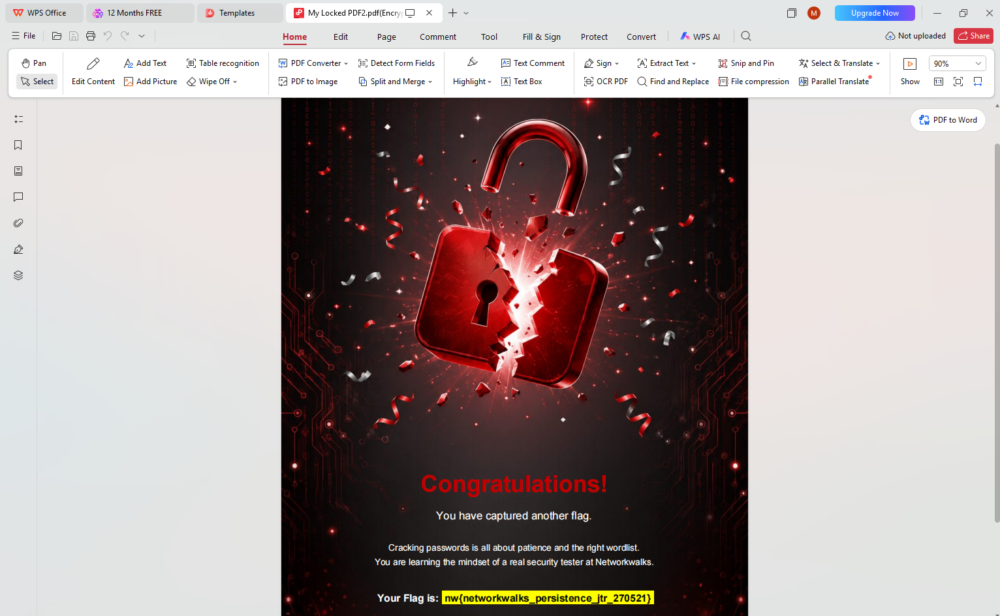

# 🔐 Password Security & Auditing with John the Ripper

## Project Overview

This project involved hands-on practice with password security, password recovery, and password auditing using **John the Ripper (JTR)** and its graphical interface, **Johnny**.

The main goal was to understand how password-protected files can be audited by analyzing password hashes and applying dictionary-based techniques to identify weak passwords.

## Objectives

- Understand how password hashing works in practice.
- Learn how to extract password hashes from protected PDF files.
- Explore password auditing using John the Ripper and Johnny.
- Understand how dictionary-based password recovery works.
- Identify the security risks associated with weak and commonly used passwords.

## Practical Tasks Performed

1. Installed and configured John the Ripper on Windows.
2. Explored the Johnny graphical user interface.
3. Extracted the password hash from a protected PDF file.
4. Prepared and imported the extracted hash for analysis.
5. Performed dictionary-based password auditing.
6. Verified the recovered password by opening the protected PDF.
7. Reviewed the importance of strong and unique passwords.

## Tools & Technologies

| Tool / Technology | Purpose |
|---|---|
| John the Ripper (JTR) | Password hash auditing |
| Johnny GUI | Graphical interface for John the Ripper |
| Windows | Operating environment |
| PDF Hash Analysis | Extracting password hashes |
| Dictionary-Based Auditing | Testing password strength |
| NetworkWalks Hash calculator | Extracting password hashes |
| NetworkWalks Password craker | Password Exraction |

## Key Learnings

Through this exercise, I gained practical experience in password auditing and hash analysis. I learned how dictionary-based techniques can expose weak or commonly used passwords and gained a better understanding of the importance of strong password policies.

The project also helped me understand a practical workflow used in authorized security assessments, particularly when evaluating the strength of password protection.

## 📸 Practical Demonstration & Screenshots

## Security & Authorization

All activities were performed in an authorized cybersecurity training environment using a provided practice file. The exercise was conducted strictly for educational purposes.

## Author
Muhabwa Davies.
